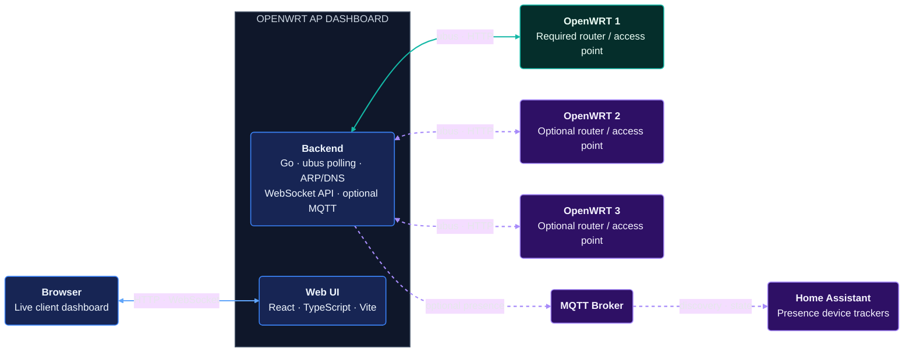

# OpenWRT AP Dashboard

A unified dashboard to monitor and manage WiFi clients across multiple OpenWRT routers and access points in your network.

## Features

- **Multi-Router Support**: Monitor clients across multiple OpenWRT devices simultaneously
- **Live Client List**: Real-time display of all connected WiFi clients
- **Signal Strength Visualization**: See signal quality with visual indicators
- **Client Information**: 
  - MAC address
  - IP address (with DNS resolution)
  - Connected interface/SSID
  - Signal strength and noise levels
  - TX/RX rates and packet statistics
- **Client Management**: Disconnect wireless clients remotely
- **Device Tracking**: See which device/router each client is connected to
- **Home Assistant Presence Detection**: Track configured MAC addresses across all access points and publish `home`/`not_home` states to Home Assistant via MQTT, with MQTT discovery and a configurable offline delay
- **Responsive UI**: Web-based dashboard that works on desktop and mobile

## Architecture



OpenWRT 1 is shown as the primary router; OpenWRT 2 and 3 are optional. The
MQTT broker and Home Assistant are also optional; the dashboard works without
presence tracking enabled.

## Requirements

### Host System
- Docker and Docker Compose
- Access to your OpenWRT devices via ubus
- Network connectivity to all routers

### OpenWRT Devices
- OpenWRT with ubus service running (standard)
- ubus accessible on HTTP (port 80, standard)
- Credentials (username/password) for ubus authentication
- `/proc/net/arp` readable (for IP resolution fallback)

## Quick Start

### 1. Clone and Setup

```bash
git clone <repo>
cd openwrt-ap-dashboard
```

### 2. Configure stations.yaml

Create `stations.yaml` with your router details:

```yaml
poll_interval: 10  # seconds between polling

stations:
  - id: "main-office"
    host: "192.168.1.1"
    port: 80
    username: "root"
    password: "your-password"
    ifaces:
      - "wlan0"
      - "wlan1"
    name: "Main Office"

  - id: "warehouse"
    host: "192.168.2.1"
    port: 80
    username: "root"
    password: "your-password"
    ifaces:
      - "wlan0"
    name: "Warehouse"

  - id: "guest-network"
    host: "192.168.3.1"
    port: 80
    username: "root"
    password: "your-password"
    ifaces:
      - "wlan0"
      - "wlan1"
    name: "Guest Network"

presence:
  not_home_delay_seconds: 30
  devices:
    - name: "Alice phone"
      mac: "00:11:22:33:44:55"
    - name: "Bob phone"
      mac: "aa:bb:cc:dd:ee:ff"

mqtt:
  broker: "tcp://homeassistant.local:1883"
  username: "mqtt-user"
  password: "your-mqtt-password"
  client_id: "openwrt-ap-dashboard"
  discovery_id_prefix: "openwrt_ap_dashboard"
  topic_prefix: "openwrt/presence"
  discovery_prefix: "homeassistant"
```

When `presence.devices` is configured, the backend publishes retained `home` and
`not_home` states over MQTT and registers each device through Home Assistant MQTT
discovery. All tracked entities share one Home Assistant device named
`OpenWrt AP Dashboard Presence`, grouped by a shared discovery identifier.
The `mqtt.discovery_id_prefix` setting is independent from `mqtt.client_id` and
defaults to `openwrt_ap_dashboard`. Keep it stable after setup so Home Assistant
continues to recognize the same device and entities.
Presence is based on association with any configured station; a
station is only considered absent after a successful poll of all its configured
wireless interfaces. A device must remain absent for
`presence.not_home_delay_seconds` before `not_home` is published (default: 30
seconds); `home` is published immediately. MQTT is optional when no presence
devices are configured.

### 3. Docker Setup

Update `docker-compose.yml` if needed (defaults work for most setups):

```yaml
services:
  openwrt-dash:
    build: .
    container_name: openwrt-dash
    environment:
      - BACKEND_PORT=8189
    ports:
      - "8189:8189"
    volumes:
      - ./stations.yaml:/stations.yaml:ro
    network_mode: host  # Required for local ARP lookup
    restart: unless-stopped
```

### 4. Run with Docker

```bash
docker-compose up -d
```

Then open: **http://localhost:8189**

### 5. Local Development

Without Docker:

```bash
# Terminal 1: Backend
cd backend
go build
./backend -config ../stations.yaml

# Terminal 2: Frontend
cd frontend
npm install
npm run dev

# Open http://localhost:5173
```

## Configuration Details

### stations.yaml

- **poll_interval**: How often (in seconds) to query routers. Default: 15
- **id**: Unique identifier for this router (used internally)
- **host**: IP or hostname of the OpenWRT device
- **port**: ubus port (usually 80)
- **username/password**: ubus authentication credentials (typically root)
- **ifaces**: List of wireless interfaces to monitor (e.g., wlan0, wlan1, wlan2)
- **name**: Display name in the dashboard
- **presence.devices**: Devices to track, each with a Home Assistant display name and MAC address
- **presence.not_home_delay_seconds**: How many seconds a device must remain absent before publishing `not_home`. Default: 30
- **mqtt.broker**: MQTT broker URL (required when presence devices are configured)
- **mqtt.username/password**: Optional broker credentials
- **mqtt.client_id**: MQTT client ID. Default: `openwrt-ap-dashboard`
- **mqtt.discovery_id_prefix**: Stable prefix for Home Assistant discovery entity and device identifiers. Default: `openwrt_ap_dashboard`
- **mqtt.topic_prefix**: State topic prefix. Default: `openwrt/presence`
- **mqtt.discovery_prefix**: Home Assistant discovery prefix. Default: `homeassistant`

## IP Resolution Strategy

The dashboard uses a multi-step approach to resolve client IPs:

1. **getHostHints** (from OpenWRT): Cached host information
2. **DNS Resolution**: Reverse DNS lookup on known IPs
3. **mDNS Discovery**: Local service discovery (ESPHome, Shelly, Matter, etc.)
4. **ARP Table (Remote)**: Read `/proc/net/arp` from router via ubus
5. **ARP Table (Local)**: Fallback to container's local ARP table (requires `network_mode: host`)

This ensures maximum coverage even if some methods fail.

## API & WebSocket

### HTTP Endpoints

- `GET /` - Main dashboard UI
- `GET /api/clients` - Get all clients (JSON)

### WebSocket

The backend pushes client updates via WebSocket at `/ws`. Frontend automatically connects and receives real-time updates.

## Docker Network Mode

**Important**: The container uses `network_mode: host` for two critical features:

1. **Local ARP Fallback**: Direct access to `/proc/net/arp` on the host for IP resolution when remote ARP fails
2. **mDNS Discovery**: Multicast traffic (224.0.0.251:5353) for discovering devices like ESPHome, Shelly, Matter, etc.

Docker bridge networks don't forward multicast traffic and can't mount `/proc` filesystems, so `network_mode: host` is required.

**Implications:**
- Container shares the host's network interface
- Can access `/proc/net/arp` directly
- Can receive mDNS multicast packets
- Ports are not isolated (use firewall rules if needed)

**Without host mode:**
- ❌ mDNS Discovery will not work
- ❌ Local ARP fallback will not work
- ✅ Remote ARP from routers still works (if properly configured)

If you need to change this, update `docker-compose.yml`.

## Troubleshooting

### Clients showing without IP addresses
- Check ARP table: `cat /proc/net/arp` on your host
- Check router connectivity: Can you SSH to the routers?
- Check logs: `docker logs openwrt-dash`

### Can't connect to routers
- Verify `stations.yaml` has correct IPs, usernames, passwords
- Test ubus manually: `curl -X POST http://192.168.1.1:80/ubus -d '{"jsonrpc":"2.0","method":"call","params":["00000000000000000000000000000000","session","login",{"username":"user","password":"your-pwd"}],"id":1}'`
- Check firewall rules and ubus port accessibility

### Docker container won't start
- Ensure `network_mode: host` is set
- Check for port conflicts (default 8189)
- Review logs: `docker-compose logs -f`

## OpenWRT Requirements

**Luci is required** - This dashboard works with Luci (which is standard on OpenWRT). Luci provides uhttpd with proper RPC support.

If uhttpd is not properly serving `/ubus` calls, install:

```bash
opkg install luci-mod-rpc
# or
opkg install uhttpd-mod-rpcd
/etc/init.d/uhttpd restart
```

## OpenWRT rpcd Configuration

Configure `/etc/config/rpcd` to allow the dashboard credentials to access ubus:

```
config rpcd
        option socket '/var/run/ubus/ubus.sock'
        option timeout '30'

config login
        option username 'user'
        option password '$p$user'
        list read '*'
        list write '*'
```

Apply with:

```bash
uci commit rpcd
/etc/init.d/rpcd restart
```

This configuration allows the `user` user full read/write access to ubus (used in `stations.yaml`).

## OpenWRT ACL Configuration (Optional)

If you want remote ARP table access on OpenWRT to work without the local fallback, configure ubus ACLs:

```bash
# On your OpenWRT router:
cat <<EOF > /etc/acl_arp.json
{
    "arp_access": {
        "description": "ARP table access",
        "read": {
            "file": [ "/proc/net/arp" ]
        }
    }
}
EOF

cat <<EOF > /etc/uci-defaults/99-arp-link
#!/bin/sh
ln -sf /etc/acl_arp.json /usr/share/rpcd/acl.d/arp.json
/etc/init.d/rpcd restart
exit 0
EOF

chmod +x /etc/uci-defaults/99-arp-link
sh /etc/uci-defaults/99-arp-link

uci add_list rpcd.@login[0].acl='arp_access'
uci commit rpcd
/etc/init.d/rpcd restart
```

**Note**: This is optional if you're using `network_mode: host` in Docker.

## Development

### Backend
- Go
- Dependencies: zeroconf, go-cache, standard library
- Compile: `cd backend && go build`

### Frontend  
- Node.js
- React, TypeScript, Vite
- Install: `cd frontend && npm install`
- Dev server: `npm run dev`
- Build: `npm run build`

## License

MIT
